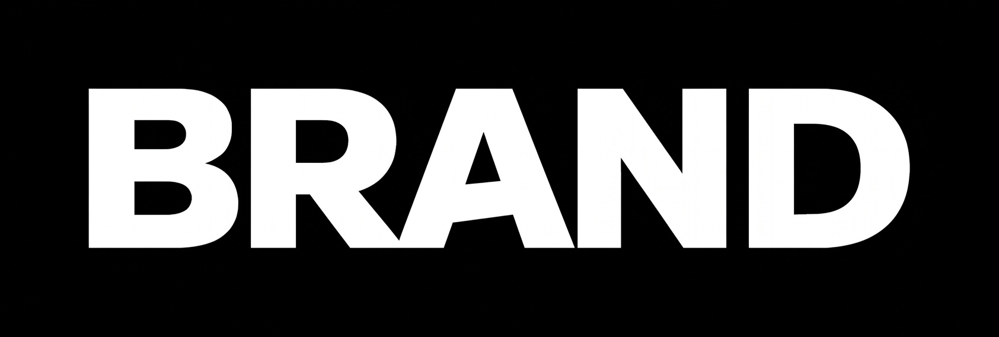

<p align="center">
  <a href="README.ja.md">日本語</a> | <a href="README.zh.md">中文</a> | <a href="README.es.md">Español</a> | <a href="README.fr.md">Français</a> | <a href="README.hi.md">हिन्दी</a> | <a href="README.md">English</a> | <a href="README.pt-BR.md">Português (BR)</a>
</p>

<p align="center">
  
</p>

<p align="center">
  <a href="https://github.com/mcp-tool-shop-org/brand/actions/workflows/ci.yml"></a>
  <a href="https://www.npmjs.com/package/@mcptoolshop/brand"></a>
  <a href="LICENSE"></a>
  <a href="https://mcp-tool-shop-org.github.io/brand/"></a>
</p>

<p align="center">
  Centralized brand asset registry for the <a href="https://github.com/mcp-tool-shop-org">mcp-tool-shop-org</a> GitHub org.<br>
  One repo holds every logo. Every README points here. Update once, update everywhere.
</p>

---

## Perché

Quando ogni repository contiene la propria copia del logo, si ottiene duplicazione, incoerenza e divergenza. Un rebranding significa dover cercare in oltre 100 repository. Questo repository risolve il problema: i loghi sono archiviati qui e i file README li fanno riferimento tramite URL `raw.githubusercontent.com`.

## Struttura

```
logos/
  <slug>/
    readme.png       # THE logo — one canonical image, format preserved as-is
    gallery/          # optional — a named collection of N extra showcase images
      side.png
      back.png
manifest.json     # SHA-256 integrity hashes for every asset, tagged role: primary | gallery
docs/
  handbook.md     # Lessons learned from migrating 100+ repos
```

Centinaia di loghi in tutta l'organizzazione. I file PNG rimangono PNG. I file JPEG rimangono JPEG. Il formato è una decisione di branding, non un obiettivo di build.

Lo "slug" `readme.<ext>` è sempre il logo canonico. Uno "slug" può anche avere una sottocartella con immagini aggiuntive (ad esempio, le rotazioni dei personaggi di un pacchetto di sprite o una serie di screenshot di un tool). Il file manifest etichetta esplicitamente ogni risorsa con il suo `role`, anziché trattare tutti i file immagine allo stesso modo. Vedere [Gallerie e README dinamici](#gallerie-e-readme-dinamici) di seguito.

## CLI

```bash
npm install -g @mcptoolshop/brand

# Verify all logos match their manifest hashes
brand verify

# Regenerate manifest after adding/replacing a logo
brand manifest

# CI mode — fail if manifest is out of date
brand manifest --check

# Show registry summary — counts, formats, sync status
brand stats
brand stats --json

# Audit repos for broken refs, badge collisions, indentation traps
brand audit --repos /path/to/clones

# Audit against the live org without cloning anything, and reconcile the
# registry against it — reports renamed, archived, and orphaned slugs.
# Opt-in network access; needs GH_TOKEN or GITHUB_TOKEN.
brand audit --remote --org mcp-tool-shop-org

# Show a slug's asset history from git — added/changed/removed, with hashes
brand history <slug>
brand history <slug> --limit 5 --json

# Remove a slug (or just one of its galleries). Destructive, so --yes is
# required; --dry-run shows exactly what would go first.
brand remove <slug> --dry-run
brand remove <slug> --yes
brand remove <slug> --gallery turnarounds --yes

# Migrate READMEs to point at brand repo (dry run first)
brand migrate --repos /path/to/clones --dry-run
brand migrate --repos /path/to/clones

# Register a directory of images as a named gallery for a slug
brand add-gallery <slug> /path/to/turnarounds --dry-run
brand add-gallery <slug> /path/to/turnarounds

# Sync a consuming repo's README gallery block from the manifest
brand sync --slug <slug> --repos /path/to/clones --check
brand sync --slug <slug> --repos /path/to/clones
```

## Sincronizzazione automatica

Un'azione GitHub giornaliera (`sync.yml`) esegue la scansione di tutti i repository dell'organizzazione alla ricerca di loghi, scarica le risorse nuove o modificate, rigenera il file manifest e apre una richiesta di pull (PR). È anche possibile attivarla manualmente tramite `workflow_dispatch`.

Lo script di sincronizzazione si trova in `scripts/sync-org-logos.sh` e può essere eseguito localmente:

```bash
# Preview what would change
./scripts/sync-org-logos.sh --dry-run

# Sync logos from the org
./scripts/sync-org-logos.sh
```

### Configurazione (una tantum, per ogni fork)

Il flusso di lavoro di sincronizzazione apre una PR, quindi richiede il permesso per farlo. Scegliere una di queste opzioni nelle impostazioni del repository:

1. **Abilitare la creazione di PR per le azioni.** Impostazioni -> Azioni -> Generale -> "Consenti alle azioni GitHub di creare e approvare richieste di pull" -> ATTIVATO. È la soluzione più semplice; non richiede la gestione di segreti aggiuntivi. ([Documentazione GitHub](https://docs.github.com/en/repositories/managing-your-repositorys-settings-and-features/enabling-features-for-your-repository/managing-github-actions-settings-for-a-repository#preventing-github-actions-from-creating-or-approving-pull-requests))
2. **Fornire un segreto di repository `SYNC_PAT`.** Token di accesso personale con gli ambiti `contents:write` + `pull-requests:write`. Questa opzione attiva anche la CI a valle sulla PR automatica (l'impostazione predefinita `GITHUB_TOKEN` non lo fa).

Se non si configura una di queste opzioni, il flusso di lavoro giornaliero fallisce ogni mattina alle `gh pr create` a causa di un errore di autorizzazione.

### Risoluzione dei problemi

| Sintomo | Causa | Soluzione |
| --- | --- | --- |
| `gh pr create` 403 | Nessuna delle opzioni di configurazione di cui sopra è configurata | Scegliere l'opzione 1 o 2 di cui sopra |
| Il flusso di lavoro giornaliero non apre alcuna PR, non cambia nulla | Tutti i repository dell'organizzazione o non hanno un logo, oppure i loghi sono già uguali | È previsto: le esecuzioni senza modifiche sono normali |
| La verifica del file manifest è fallita | I loghi sono stati scaricati, ma il file manifest presenta un hash non corrispondente | Viene creata automaticamente un'issue `sync-failure`; rieseguire `brand manifest && brand verify` localmente |
| Una PR di sincronizzazione introduce un logo errato | Il repository upstream ha pubblicato un'immagine corrotta o con contenuto errato | Annullare l'unione: `git revert <merge-sha> && brand manifest && git commit --amend --no-edit && git push`. Vedere [SECURITY.md](SECURITY.md#incident-response) |

## Gallerie e README dinamici

Alcuni prodotti richiedono più di un'immagine di presentazione per "slug": le rotazioni dei personaggi di un pacchetto di sprite in 8 direzioni, una serie di screenshot di un tool. `brand` tratta questi elementi come una **galleria** di primo livello, distinta dal logo canonico, anziché come un insieme anonimo di file aggiuntivi:

```bash
# Register a directory of images as a gallery (idempotent — re-run any time
# source-dir changes; new files are added, changed files updated, deleted
# files removed. Regenerates manifest.json automatically.)
brand add-gallery pirate-raiders-3d-2 /path/to/turnarounds
```

Per visualizzare questa galleria in un **file README del repository di destinazione** e mantenerla sincronizzata quando la galleria cambia, inserire una coppia di marcatori ovunque nel file README:

```html
<!-- brand:gallery:start slug="pirate-raiders-3d-2" -->
<!-- brand:gallery:end -->
```

Quindi, eseguire:

```bash
brand sync --slug pirate-raiders-3d-2 --repos /path/to/clones
```

`sync` rigenera tutto ciò che si trova tra i marcatori dal file manifest: output deterministico e identico ad ogni esecuzione con input invariati, quindi si integra perfettamente con la CI. `--check` segnala le modifiche senza scrivere (esce con codice 1 se il file README è obsoleto, 0 se è aggiornato) e può essere integrato nel flusso di lavoro della CI del repository di destinazione nello stesso modo in cui `brand manifest --check` controlla questo flusso di lavoro. Questa è una sezione del **README dinamico**: il contenuto scritto manualmente attorno ai marcatori rimane invariato; tutto ciò che si trova tra i marcatori è di proprietà della macchina e può essere rigenerato in qualsiasi momento. Il prefisso `brand:gallery:` è con uno spazio dei nomi in modo che i tipi di blocco futuri (badge, statistiche) possano condividere un file README senza conflitti.

`brand audit` comprende anche la differenza: un file README con più tag della galleria `` per uno "slug" non viene più segnalato come un possibile conflitto di badge; se non è ancora collegato a un blocco di marcatore, `audit` suggerisce `brand sync`.

## Aggiunta manuale di un logo

1. Inserire il file in `logos/<slug>/readme.png` (o `.jpg`)
2. Eseguire `brand manifest` per aggiornare gli hash di integrità
3. Eseguire il commit sia del logo che del file `manifest.json`
4. La CI verifica il file manifest al push

Il passaggio 2 è facile da dimenticare e, localmente, non viene segnalato alcun errore: il commit del logo
ha esito positivo, il sito viene comunque compilato, i test vengono comunque superati e l'errore si manifesta solo
nella CI dopo il push. Quindi, un hook `pre-commit` lo fa automaticamente: crea una modifica
in `logos/` e rigenera e crea il commit di `manifest.json` nello stesso commit.

Si installa in `npm install` (tramite `prepare` → [`scripts/install-hooks.mjs`](scripts/install-hooks.mjs),
che punta `core.hooksPath` a [`.githooks/`](.githooks/)). Per installarlo manualmente:

```bash
git config core.hooksPath .githooks
```

L'hook richiede che `dist/` sia compilato (`npm run build`) poiché esegue la CLI e
non cerca di indovinare quando `logos/` ha modifiche non ancora aggiunte: il file manifest viene calcolato
a partire dall'albero di lavoro, quindi, se questo non corrisponde a ciò che si sta eseguendo il commit,
gli hash che scrive descriverebbero byte che il commit non contiene. `git commit --no-verify` lo ignora e la CI applica comunque la stessa regola.

## Sicurezza

| Aspetto | Dettagli |
|--------|--------|
| **Data touched** | File di immagini dei loghi e delle gallerie in `logos/` (lettura), `manifest.json` (lettura/scrittura), file README (lettura/scrittura durante la migrazione e la sincronizzazione: `sync` riscrive solo il contenuto tra i marcatori `brand:gallery:start`/`end`) |
| **Data NOT touched** | Nessuna telemetria, nessun sistema di analisi, nessuna esecuzione di codice dai file di loghi/gallerie |
| **Permissions** | Lettura: file di loghi/gallerie, file manifest, file README. Scrittura: manifest.json, file README (solo migrazione/sincronizzazione) e `logos/<slug>/` (solo `remove`, che richiede `--yes`) |
| **Network** | Nessuno per impostazione predefinita. `brand audit --remote` è l'unica eccezione ed è strettamente facoltativo: senza tale flag, non viene effettuata alcuna chiamata di rete. `sync`, `verify`, `manifest`, `stats`, `migrate`, `add-gallery`, `remove` e `history` sono completamente offline. |
| **Telemetry** | Nessuno raccolto o inviato |

Ogni logo è tracciato tramite l'hash SHA-256 in `manifest.json`. La CI esegue `brand manifest --check` su ogni push che modifica `logos/` o `manifest.json`. Vengono tracciati solo i file immagine (`.png`, `.jpg`, `.jpeg`, `.svg`, `.webp`); i file non immagine in `logos/` vengono ignorati.

**Cosa dimostra e cosa non dimostra l’hash.** Una discrepanza individua una sovrascrittura accidentale, un file corrotto o una divergenza tra il disco e il file manifest: si tratta degli errori più comuni. Non impedisce una manomissione intenzionale: chiunque abbia accesso in scrittura può sostituire un logo, eseguire `brand manifest` e salvare entrambe le modifiche, dopodiché `verify` viene accettato. L’hash dimostra che l’albero è internamente coerente, ma non che il suo contenuto sia stato approvato. Ciò che colma effettivamente questa lacuna sono i controlli del repository, uniti al meccanismo di rilevamento delle divergenze della sincronizzazione giornaliera, che verifica ogni logo del registro rispetto al repository di origine: vedere [SECURITY.md](SECURITY.md#the-limit-of-the-manifest--read-this-before-trusting-it) e [`.github/SECURITY-CONTROLS.md`](.github/SECURITY-CONTROLS.md).

Le segnalazioni di vulnerabilità vengono inviate al [canale di comunicazione privato](https://github.com/mcp-tool-shop-org/brand/security/advisories/new) di GitHub. Per la politica completa, vedere [SECURITY.md](SECURITY.md), e per la guida alla migrazione, [docs/handbook.md](docs/handbook.md).

## Scheda di valutazione

| Categoria | Punteggio |
|----------|-------|
| A. Sicurezza | 10 |
| B. Gestione degli errori | 10 |
| C. Documentazione per gli operatori | 10 |
| D. Pratiche di rilascio | 10 |
| E. Identità (soft) | 10 |
| **Overall** | **50/50** |

Ogni riga D è verde: matrice Node 20/22/24, azioni con hash SHA, passaggio `npm audit`, Dependabot, contenuto del tarball e piena parità tra tag/release/npm (risolto il 2026-07-01 — v1.0.2/v1.0.3 non sono mai stati pubblicati su npm; contrassegnati retroattivamente per la parità con git/CHANGELOG).

> Audit completo: [SHIP_GATE.md](SHIP_GATE.md) · [SCORECARD.md](SCORECARD.md)

## Licenza

[MIT](LICENSE)

---

<p align="center">
  Built by <a href="https://mcp-tool-shop.github.io/">MCP Tool Shop</a>
</p>
